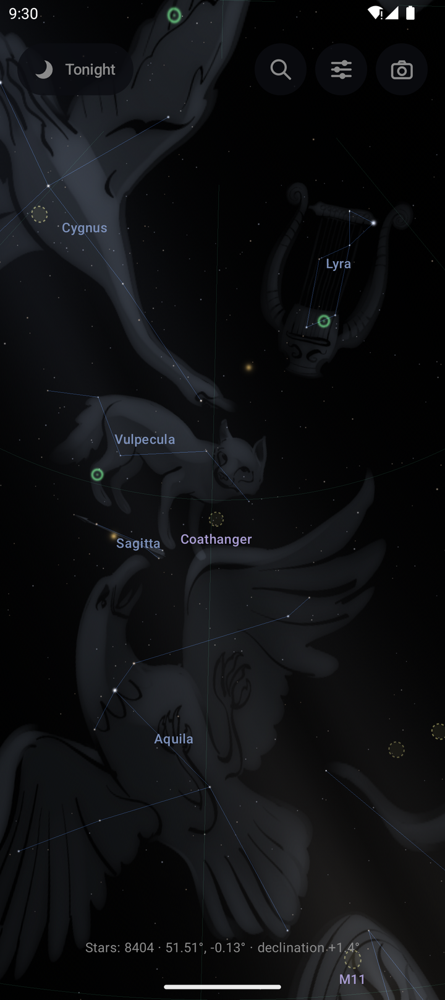
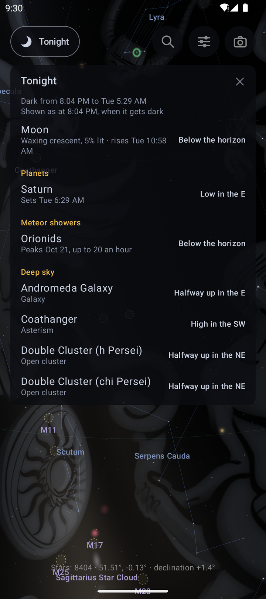
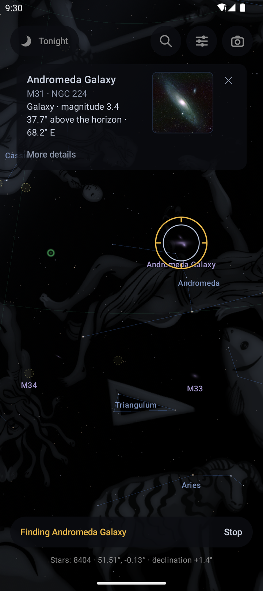
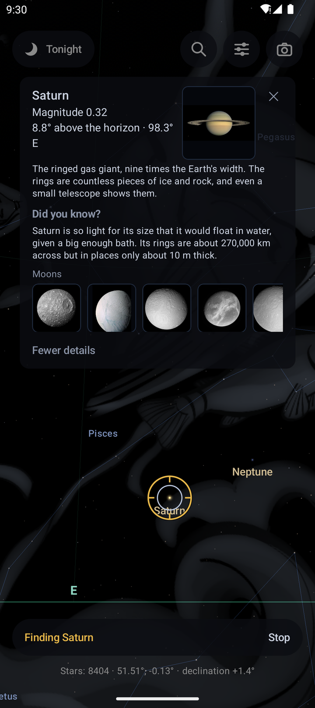

# Skyglass

**Hold your phone up to the night sky and see what you're looking at.**

Skyglass is a stargazing app for Android. Point your phone at any patch of sky and it shows the stars, constellations, planets and galaxies that are there, lined up with the real thing as you move. Tap anything to find out what it is. Ask it what's worth seeing tonight, and it will steer you there.

It works offline, has no ads, no account and no tracking. It doesn't even ask for internet access.

<p align="center">
  
  &nbsp;
  
  &nbsp;
  
  &nbsp;
  
</p>
<p align="center"><sub>The Summer Triangle · What's up tonight · Finding the Andromeda Galaxy · Saturn and its moons</sub></p>

## What you can do with it

### Know what you're looking at
- **Every star you can see with your eyes**, about 8,400 of them, placed where they really are from where you're standing, right now.
- **All 88 constellations**, with their lines, names and the classic illustrations from Stellarium, so Cygnus looks like a swan and Leo like a lion.
- **The Sun, the Moon (in its real phase) and the planets.** Zoom in on Jupiter or Saturn and their moons appear beside them.
- **About 175 galaxies, nebulae and star clusters**, including every Messier object, plus the Milky Way stretched across the sky.
- **Tap anything** to find out what it is: how high it is, when it rises and sets, how far away it is, and a "Did you know?" fact. Galaxies, nebulae and planets come with real photographs from NASA, ESA/Hubble and ESO.
- **Tap a constellation** for its myth, its brightest stars and a chart.

### Find something worth seeing
- **Tonight** tells you when it gets properly dark, what the Moon is doing, which planets are up, which meteor showers are active, and the best galaxies and clusters overhead. Each one is described in plain words ("halfway up in the east"), and a tap takes you to it.
- **Search** for any star, planet, constellation or deep-sky object by name or catalogue number (Vega, M42, NGC 7000, "Double Cluster"). An arrow points the way until it's in view, then a ring marks the spot.

### See it your way
- **Camera view** draws the sky over your phone's live camera, so labels sit on the real stars.
- **Pinch to zoom** from a 90° view down to 1°, close enough to see Jupiter's moons line up.
- **Night mode** turns everything red, so your eyes stay adjusted to the dark.
- **Faintest stars slider** matches the app to your sky: drop it in a city, push it up under a dark country sky.
- Switch the artwork, horizon, grid, Milky Way and deep-sky objects on or off.

## Your first night with Skyglass

1. Go outside, open Skyglass and allow location access, so it knows which sky you're under.
2. Tap **Tonight** and pick something from the list: a planet is the easiest start.
3. Follow the arrow until the ring appears, then look up from the screen. That's it.

If the sky looks a few degrees off, wave the phone in a slow figure of eight to calibrate the compass, and keep away from cars, railings and other metal.

## Getting it

Skyglass needs Android 9 or later and a phone with a compass and GPS. A gyroscope makes the view much smoother.

Build and install it from source with Android Studio, or from the command line with a phone connected:

```bash
./gradlew installDebug
```

## Privacy

Skyglass has no internet permission, so nothing you do in it can leave your phone. Your location is used only to work out the sky above you. The camera is used only for the camera view, and only if you turn it on. Everything the app shows (catalogues, artwork, photos) is built in.

## How it works

Positions come from the Yale Bright Star Catalogue, corrected for the stars' own motion and for the slow wobble of the Earth's axis, from Jean Meeus' *Astronomical Algorithms* for the Sun, the Moon and the planets' moons, and from JPL's orbital elements for the planets. The phone's gyroscope gives smooth motion and its compass gives north, corrected for your local magnetic declination. The sky is drawn with OpenGL ES.

The design notes, with the reasoning behind each feature, data sources and known limits, are in [docs/design-notes.md](docs/design-notes.md).

## Credits

- Stars: Yale Bright Star Catalogue, 5th revised edition (Hoffleit & Warren, via CDS).
- Constellation artwork: Johan Meuris, from [Stellarium](https://stellarium.org)'s modern sky culture, under the Free Art License 1.3; placement data under CC BY-SA 4.0.
- Photos: NASA (public domain), and ESA/Hubble, ESO and NOIRLab under CC BY 4.0. Each photo's credit is shown in the app.
